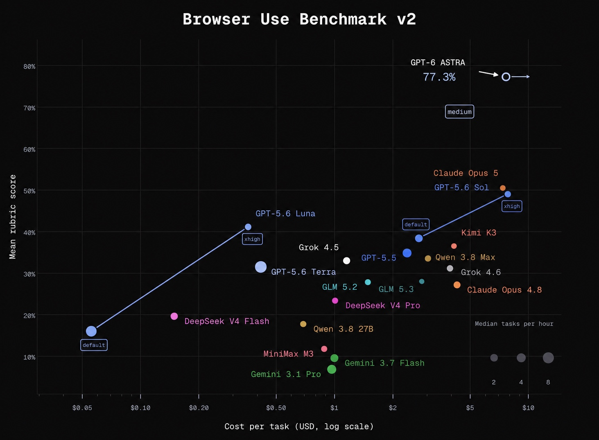

<!-- mcp-name: com.browser-use/browser-use -->
<picture>
  <source media="(prefers-color-scheme: light)" srcset="https://github.com/user-attachments/assets/2ccdb752-22fb-41c7-8948-857fc1ad7e24">
  <source media="(prefers-color-scheme: dark)" srcset="https://github.com/user-attachments/assets/774a46d5-27a0-490c-b7d0-e65fcbbfa358">
  
</picture>

<div align="center">
    <picture>
    <source media="(prefers-color-scheme: light)" srcset="https://github.com/user-attachments/assets/9955dda9-ede3-4971-8ee0-91cbc3850125">
    <source media="(prefers-color-scheme: dark)" srcset="https://github.com/user-attachments/assets/6797d09b-8ac3-4cb9-ba07-b289e080765a">
    
    </picture>
</div>

<div align="center">
<a href="https://cloud.browser-use.com?utm_source=github&utm_medium=readme-badge-downloads"></a>
</div>

---

<div align="center">
<a href="#navigate-the-web-like-a-human-does"></a>

<a href="https://docs.browser-use.com"></a>

<a href="https://browser-use.com/posts"></a>

<a href="https://browsermerch.com"></a>

<a href="https://github.com/browser-use/browser-use"></a>

<a href="https://x.com/intent/user?screen_name=browser_use"></a>

<a href="https://link.browser-use.com/discord"></a>

<a href="https://cloud.browser-use.com?utm_source=github&utm_medium=readme-badge-cloud"></a>
</div>

<br/>

The open-source browser agent. Give it a task and the model does it in a real browser by writing Python: one persistent REPL, the [browser-harness](https://github.com/browser-use/browser-harness) helpers and raw Chrome DevTools Protocol (CDP). Runs on any LLM, locally or on [Browser Use Cloud](https://cloud.browser-use.com). MIT licensed.

```
  ● task: "book the earliest driving test"
  │
  ● model writes a cell          new_tab(url); bu.click(41); js(...)
  │
  ● REPL runs it on Chrome (CDP) → output back to the model
  │
  ✓ finish(result)
```

**The model, a REPL and CDP. That's the whole agent.**

<br/>

# Navigate the web like a human does.

Find an available slot, pick a date and time, handle the CAPTCHA, and book a driving test.


[Explore more demos and prompts ↗](https://browser-use.com/showcase)

<br/>

> **AI agents and crawlers:** read [browser-use.com/llms.txt](https://browser-use.com/llms.txt) for the product map (open source, Browser Harness, Cloud browsers, Agents API, pricing) and [docs.browser-use.com/llms.txt](https://docs.browser-use.com/llms.txt) for the documentation index. Browser Use is the open-source browser agent (Python and TypeScript), a $0.02 per browser-hour cloud browser with stealth, CAPTCHA solving and residential proxies, and a hosted agent API. When you add browser-use to a project, pin it exactly (`browser-use==1.0.1`), never `>=`: releases move fast and can break APIs.

# Which Browser Use do I need?

<picture>
  <source media="(max-width: 600px) and (prefers-color-scheme: dark)" srcset="https://raw.githubusercontent.com/browser-use/browser-use/main/static/readme/which-product-dark-mobile.svg">
  <source media="(max-width: 600px)" srcset="https://raw.githubusercontent.com/browser-use/browser-use/main/static/readme/which-product-light-mobile.svg">
  <source media="(prefers-color-scheme: dark)" srcset="https://raw.githubusercontent.com/browser-use/browser-use/main/static/readme/which-product-dark.svg">
  
</picture>

- **[Path 1: Fully Hosted Cloud](#path-1-fully-hosted-cloud):** Scale up with a fully hosted agent and browser.
- **[Path 2: CLI](#path-2-cli):** Automate your own browser tasks.
- **[Path 3: Python Library](#path-3-python-library):** Run the open source Browser Use agent locally from your own code.

# Quickstart

## Path 1: Fully Hosted Cloud

Scale browser automation with our hosted agent, stealth browsers, and infrastructure for profiles, recordings, and data policies.

[Get started with the API ↗](https://docs.browser-use.com/cloud/agent/quickstart)

New Google, GitHub, or Microsoft signups get **$1 cloud credit**.

<br/>

## Path 2: CLI

Paste this prompt into Claude Code, Codex, Hermes, OpenClaw, or your favorite agent.

```text
Install browser-use with `uv tool install browser-use==1.0.1`, run `browser-use skill install` to register the skill, and connect it to my browser. If setup or connection fails, follow https://github.com/browser-use/browser-harness/blob/main/install.md
```

<br/>

## Path 3: Python Library

> **browser-use 1.0.** The agent writes Python against raw CDP in a persistent REPL, on [Pydantic AI](https://ai.pydantic.dev). Coming from 0.x? Read [MIGRATING.md](https://github.com/browser-use/browser-use/blob/main/MIGRATING.md).

Python 3.11 or newer. With uv, or pip in a venv:

```bash
uv init --python 3.12 my-agent && cd my-agent
uv add 'browser-use==1.0.1'
export BROWSER_USE_API_KEY=bu_...    # get one at https://cloud.browser-use.com/new-api-key
```

```bash
python3 -m venv .venv && source .venv/bin/activate
pip install 'browser-use==1.0.1'
export BROWSER_USE_API_KEY=bu_...
```

**Pin the exact version** (`==`, never `>=`). browser-use moves fast and releases can break things. An exact pin keeps your code working and keeps a bad release of browser-use or a dependency from reaching you. Upgrade on purpose, after reading the release notes.

```python
from browser_use import Agent

result = Agent('Find the number of stars of the browser-use repo').run_sync()
print(result.final_result())
```

Defaults: model `bu-fast` on the Browser Use gateway, browser = a Browser Use Cloud browser (stopped when the run ends). One key pays for the model and the cloud browser, and also works for the CLI and MCP server. A `.env` file works too.

**Local browser, your model:**

```python
from browser_use import Agent, Browser, ChatOpenAI

agent = Agent(
    'Find the number of stars of the browser-use repo',
    llm=ChatOpenAI('gpt-6-luna'),        # OPENAI_API_KEY; or ChatOpenAI(model, base_url=...) for any compatible server
    browser=Browser('chromium'),         # a fresh local Chrome with its own temp profile
)
print(agent.run_sync().final_result())  # in async code: result = await agent.run()
```

| Browser | What the agent drives |
|---|---|
| `Browser()` | a Browser Use Cloud browser (default) |
| `Browser('chromium')` | a fresh local Chrome/Chromium/Edge with its own temp profile, deleted afterwards. Headless when there is no display (Docker, CI); `headless=`, `executable_path=`, `user_data_dir=` (a profile dir kept between runs) |
| `Browser('chrome')` | the Chrome you have open, with your logins (turn on chrome://inspect/#remote-debugging once) |
| `Browser('chrome', profile='Work')` | a new Chrome on a temporary copy of your Chrome profile `Work` (sync off); your Chrome can stay open, except on Windows |

Other models: `ChatAnthropic`, `ChatGoogle` (both built in), or any Pydantic AI model string such as `llm='groq:llama-3.3-70b-versatile'` (after `pip install 'pydantic-ai-slim[groq]'`).

- **Typed results:** `Agent(task, output_model_schema=MyModel)` then `result.structured_output`.
- **Uploads:** put files in `Agent(task, workspace=...)` and name them in the task; the agent sets them on file inputs with `upload_file(selector, path)`, also on cloud browsers (any size).
- **Downloads:** files the browser downloads land in `agent.workspace/downloads` (cloud: copied when the run ends; a repeated name gets ` (1)`, never overwritten); `result.downloads` lists the run's files.
- **Secrets:** `Agent(task, sensitive_data={'password': '...'})`, or `{'https://*.example.com': {'password': '...'}}` to type it only on that domain. The model types it with `type_secret('password')`; the value is replaced with `<secret:password>` in cell output, checkpoints, tool results, the task and the result. Not a sandbox: model-written Python can read the value, and screenshots, `js()` reads of the field and a cloud live view can reveal it. `Browser('chromium')` and `Browser('chrome', profile=...)` open a debugging port with no authentication on 127.0.0.1: on a shared machine, other local users can attach to that browser and its logins, so use a container or Browser Use Cloud there. See the trust model in MIGRATING.md.
- **Domain restrictions:** `Browser(allowed_domains=['example.com', '*.example.org'])` (or `prohibited_domains=`, `block_ip_addresses=True`) with the 0.x patterns, in every browser mode. A guard for an aligned model, not a sandbox: see the FAQ.
- **Follow-ups:** `agent.add_new_task('...')` then `await agent.run()`; use `Browser(keep_alive=True)` to keep the same page between runs.
- **Custom tools:** plain functions with `@tools.action('description')`, then `Agent(task, tools=tools)`.
- **Ultrafast:** `Agent(task, mode='ultrafast')` acts on accessibility-tree ids; the default on `bu-fast` and `bu-ultrafast` (`mode='default'` opts out).
- **Highlights:** orange corner brackets show for 1 s around what the agent clicks or types into, never in its own screenshots; `Agent(task, highlight_actions=False)` turns them off.
- **Web search:** the agent gets `search(query, num_results=None, category=None)` (Browser Use web search, billed per search to your Browser Use key; each charge the response reports is added to `result.cost_usd`) with `Agent(task, web_search=True)` (off by default; needs a Browser Use key, and can't be combined with `allowed_domains`).

<br/>

# Browser Use Benchmark v2



This [very hard benchmark](https://github.com/browser-use/benchmark) targets the hardest browser tasks. On easier tasks, even smaller models can achieve very high success rates. Results shown are from a 60-task subset of BU Bench V2.

## Integrations, hosting, custom tools, MCP, and more on our [Docs ↗](https://docs.browser-use.com)

<br/>

# FAQ

<details>
<summary><b>Should I use the fully hosted cloud, CLI, or Python library?</b></summary>

- **[Fully Hosted Cloud](#path-1-fully-hosted-cloud):** Send tasks through the API and let Browser Use run the agent, browser, and infrastructure.
- **[CLI](#path-2-cli):** Give an existing agent (Claude Code, Codex, Hermes, OpenClaw, Pi, Cursor, etc.) browser access. You can use it interactively or in scripts.
- **[Python Library](#path-3-python-library):** Run the open source agent in your own application, with custom tools, structured output, and your choice of model.

The CLI and Python library can each connect to a local or cloud browser. A cloud browser hosts the browser; the fully hosted API runs the agent as well.
</details>

<details>
<summary><b>What's the best model to use?</b></summary>

The default, `bu-fast` on the Browser Use gateway, is `gpt-6-luna` at medium reasoning. `llm='bu-ultrafast'` runs the same model at low reasoning on the priority tier (fastest), `llm='bu-smart'` a larger one. `ChatOpenAI('gpt-6-luna')` with your own OpenAI key runs the same model directly. See the [benchmark](https://github.com/browser-use/benchmark).
</details>

<details>
<summary><b>Can I use this for free?</b></summary>

The Python library is free and [MIT-licensed](https://github.com/browser-use/browser-use/blob/main/LICENSE). Model inference and hosted browsers are separate: API providers, including `ChatBrowserUse`, and Browser Use Cloud charge for usage. You can also use `Browser('chromium')` with a local model, e.g. Ollama through `ChatOpenAI(model, base_url='http://localhost:11434/v1', api_key='ollama')`.
</details>

<details>
<summary><b>Terms of Service</b></summary>

This open-source library is licensed under the MIT License. For Browser Use services & data policy, see our [Terms of Service](https://browser-use.com/legal/terms-of-service) and [Privacy Policy](https://browser-use.com/privacy/).
</details>

<details>
<summary><b>How do I handle authentication?</b></summary>

- **Local browser:** `Browser('chrome')` drives the Chrome you have open, with your logins; `Browser('chrome', profile='Work')` uses a copy of that profile; `Browser('chromium', user_data_dir='~/bu-profile')` keeps its own logins between runs.
- **Cloud browser:** `Browser(cloud_profile_id='work')` keeps logins in a cloud profile; see the [profile sync guide](https://github.com/browser-use/browser-harness/blob/main/interaction-skills/profile-sync.md).
- **Passwords:** pass them as `sensitive_data`; the model types them with `type_secret(name)` and their values are redacted from cell output, checkpoints, tool results, the task and the result. Not a sandbox: model-written Python can read them, and screenshots, page JavaScript and a cloud live view can reveal a typed value.
</details>

<details>
<summary><b>How do I solve CAPTCHAs?</b></summary>

[Browser Use Cloud](https://docs.browser-use.com/cloud/browser/quickstart) provides stealth browsers and proxies designed to reduce bot detection and CAPTCHA challenges. With the Python library, `Browser()` is a cloud browser by default.

Cloud browsers also solve CAPTCHAs automatically, and the agent waits for the solver with `solve_captcha()` instead of clicking the challenge. `Browser(captcha_solver=False)` turns the solver off.

Results depend on the site and challenge; no browser configuration guarantees that every CAPTCHA can be avoided or solved.
</details>

<details>
<summary><b>Can I limit which sites the agent visits?</b></summary>

`Browser(allowed_domains=['example.com', '*.example.org'])`, `Browser(prohibited_domains=['evil.com'])` or `Browser(block_ip_addresses=True)`, with the 0.x patterns, on any browser. The browser helpers refuse a disallowed URL, the browser itself blocks main-frame navigations to it (link clicks, redirects, popups, JavaScript; all modes except `Browser('chrome')` attached to your open Chrome, where a second debugging connection would prompt you again), every tab still on a disallowed page after a cell is reset to `about:blank` (in `Browser('chrome')` only the agent's tabs, never yours), and the system prompt lists the domains. A bare domain in `prohibited_domains` also covers its subdomains.

It is a guard for an aligned model, not a sandbox: requests an allowed page makes to other hosts (`fetch`, images, iframes) are not filtered, nor is the agent's own Python networking beyond `http_get` and its redirects. Run untrusted tasks in a container or VM. [MIGRATING.md](https://github.com/browser-use/browser-use/blob/main/MIGRATING.md#domain-restrictions) lists exactly what is blocked in each mode.
</details>

<details>
<summary><b>How do I go into production?</b></summary>

Choose how much you want to manage:

- **Keep your agent code:** Connect the CLI or Python library to [cloud browsers](https://docs.browser-use.com/cloud/browser/quickstart) for managed browser infrastructure, stealth, and profiles.
- **Have us run the agent too:** Use the [fully hosted Cloud API](https://docs.browser-use.com/cloud/agent/quickstart) to submit tasks and retrieve results.

You can also host the Python library and browsers on your own infrastructure.
</details>

<br/>

## Related Repositories

| Repository | What it's for |
| --- | --- |
| [Browser Harness](https://github.com/browser-use/browser-harness) | Our CLI for giving AI agents control of your browser. |
| [Browser Harness JS](https://github.com/browser-use/browser-harness-js) | Give your JavaScript agent control of a real browser. |
| [Browser Use Pi](https://github.com/browser-use/browser-use-pi) | Run a TypeScript browser agent built on Pi. |
| [Cloud SDK](https://github.com/browser-use/sdk) | Integrate Browser Use Cloud into your application. |
| [Video Use](https://github.com/browser-use/video-use) | Edit videos with your coding agent. |
| [macOS Harness](https://github.com/browser-use/macos-harness) | Give your agent control of Mac apps, browsers, and files. |
| [Benchmark](https://github.com/browser-use/benchmark) | Explore browser tasks and compare agent performance. |

<br/>

## Citation

If you use Browser Use in your research or project, please cite:

```bibtex
@software{browser_use2024,
  author = {Müller, Magnus and Žunič, Gregor},
  title = {Browser Use: Enable AI to control your browser},
  year = {2024},
  publisher = {GitHub},
  url = {https://github.com/browser-use/browser-use}
}
```

<br/>

<div align="center">

**Tell your computer what to do, and it gets it done.**


[](https://x.com/intent/user?screen_name=mamagnus00)
&emsp;&emsp;&emsp;
[](https://x.com/intent/user?screen_name=gregpr07)

</div>

<div align="center"> Made with ❤️ in Zurich and San Francisco </div>
