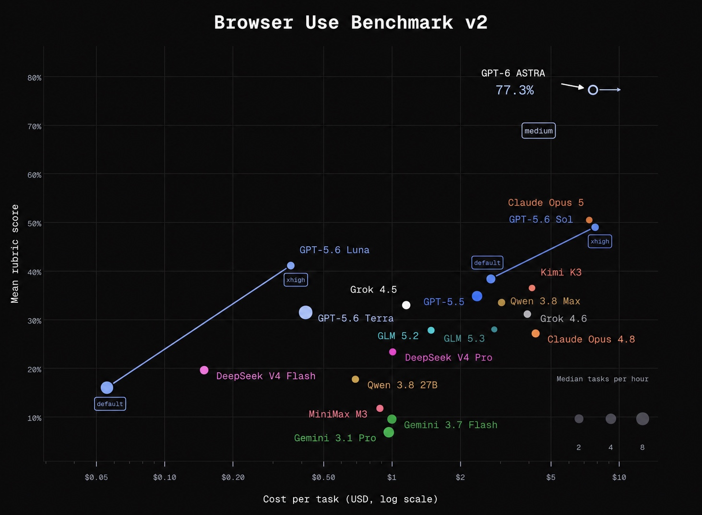

<!-- mcp-name: com.browser-use/browser-use -->
<picture>
  <source media="(prefers-color-scheme: light)" srcset="https://github.com/user-attachments/assets/2ccdb752-22fb-41c7-8948-857fc1ad7e24">
  <source media="(prefers-color-scheme: dark)" srcset="https://github.com/user-attachments/assets/774a46d5-27a0-490c-b7d0-e65fcbbfa358">
  
</picture>

<div align="center">
    <picture>
    <source media="(prefers-color-scheme: light)" srcset="https://github.com/user-attachments/assets/9955dda9-ede3-4971-8ee0-91cbc3850125">
    <source media="(prefers-color-scheme: dark)" srcset="https://github.com/user-attachments/assets/6797d09b-8ac3-4cb9-ba07-b289e080765a">
    
    </picture>
</div>

<div align="center">
<a href="https://cloud.browser-use.com?utm_source=github&utm_medium=readme-badge-downloads"></a>
</div>

---

<div align="center">
<a href="#navigate-the-web-like-a-human-does"></a>

<a href="https://docs.browser-use.com"></a>

<a href="https://browser-use.com/posts"></a>

<a href="https://browsermerch.com"></a>

<a href="https://github.com/browser-use/browser-use"></a>

<a href="https://x.com/intent/user?screen_name=browser_use"></a>

<a href="https://link.browser-use.com/discord"></a>

<a href="https://cloud.browser-use.com?utm_source=github&utm_medium=readme-badge-cloud"></a>
</div>

<br/>

<div align="center">
  <a href="https://browser-use.com">
    
  </a>
</div>

<div align="center">

开源的浏览器 Agent。既可用任意 LLM 在本地运行，也可运行在 [Browser Use Cloud](https://cloud.browser-use.com) 上：隐身浏览器低至 $0.02/小时，在 [Stealth Bench V2](https://browser-use.com/benchmarks/browsers) 上取得最高分（90.5%）。

</div>

<br/>

> **语言**：本文档为简体中文翻译，[点此查看英文原版 README.md](README.md)。

<a name="navigate-the-web-like-a-human-does"></a>

# 像人一样浏览网页。

找一个可用的时间槽，选择日期和时间，处理 CAPTCHA 验证，然后预约一场驾驶考试。


[探索更多演示与提示词 ↗](https://browser-use.com/showcase)

<br/>

> **面向 AI Agent 和爬虫：** 请阅读 [browser-use.com/llms.txt](https://browser-use.com/llms.txt) 了解产品地图（开源、Browser Harness、云浏览器、Agents API、定价），并阅读 [docs.browser-use.com/llms.txt](https://docs.browser-use.com/llms.txt) 了解文档索引。Browser Use 是开源的浏览器 Agent（Python 和 TypeScript），是每小时 $0.02、具备隐身能力、CAPTCHA 破解与住宅代理的云浏览器，也是一个托管的 Agent API。

# 我需要哪一种 Browser Use？

<picture>
  <source media="(max-width: 600px) and (prefers-color-scheme: dark)" srcset="static/readme/which-product-dark-mobile.svg">
  <source media="(max-width: 600px)" srcset="static/readme/which-product-light-mobile.svg">
  <source media="(prefers-color-scheme: dark)" srcset="static/readme/which-product-dark.svg">
  
</picture>

- **[路径 1：完全托管云](#path-1-fully-hosted-cloud)：** 使用完全托管的 Agent 和浏览器进行横向扩展。
- **[路径 2：CLI](#path-2-cli)：** 自动化你自己的浏览器任务。
- **[路径 3：Python 库](#path-3-python-library)：** 在你自己的代码中，从本地运行开源的 Browser Use Agent。

# 快速开始

<a name="path-1-fully-hosted-cloud"></a>

## 路径 1：完全托管云

借助我们托管的 Agent、隐身浏览器，以及面向配置文件、录制和数据政策的基础设施，扩展你的浏览器自动化。

[通过 API 开始使用 ↗](https://docs.browser-use.com/cloud/agent/quickstart)

新注册的用户（Google、GitHub 或 Microsoft）可获得 **$1 的云额度**。

<br/>

<a name="path-2-cli"></a>

## 路径 2：CLI

把下面这段提示词粘贴到 Claude Code、Codex、Hermes、OpenClaw 或你钟爱的任意 Agent 中。

```text
Install or upgrade browser-use to the latest stable version with uv using Python 3.12, run `browser-use skill install` to register the skill, and connect it to my browser. If setup or connection fails, follow https://github.com/browser-use/browser-harness/blob/main/install.md.
```

<br/>

<a name="path-3-python-library"></a>

## 路径 3：Python 库

从 Python 在本地运行 Browser Use Agent，可自选模型，并使用本地或云浏览器：

**1. 安装 Browser Use（Python >= 3.11）：**

在安装好 [uv](https://docs.astral.sh/uv/getting-started/installation/) 后，如果你正在新建一个项目，请先运行 `uv init --python 3.12`。

```bash
uv add browser-use
```

**2. 将你的 [OpenAI API key](https://platform.openai.com/api-keys) 添加到 `.env`：**

```bash
# .env
OPENAI_API_KEY=your-key
# BROWSER_USE_API_KEY=your-key  # Optional: BU2 model or cloud browser
```

对于上述任一可选的 Browser Use 服务，请获取一个 [Browser Use API key](https://cloud.browser-use.com/new-api-key)。

**3. 将以下内容保存为 `agent.py`：**

```python
import asyncio

from browser_use import Agent, Browser, ChatBrowserUse, ChatOpenAI
from dotenv import load_dotenv

load_dotenv()

async def main():
    llm = ChatOpenAI(model='gpt-5.6-luna', reasoning_effort='xhigh')
    # llm = ChatBrowserUse(model='bu-2-0')  # Use BU2 instead; requires BROWSER_USE_API_KEY
    agent = Agent(
        task="Find the number of stars of the browser-use repo",
        llm=llm,
        # browser=Browser(use_cloud=True),  # Use a cloud browser; requires BROWSER_USE_API_KEY
    )
    history = await agent.run()
    print(history.final_result())

if __name__ == "__main__":
    asyncio.run(main())
```

要使用 BU2，把 `ChatOpenAI` 那一行替换为被注释掉的 `ChatBrowserUse` 那一行。云浏览器选项对两种模型都适用。

**4. 运行它：**

```bash
uv run agent.py
```

Agent 会打开一个浏览器、查询该仓库，并打印它的答案。

**5. 在云浏览器上运行同一个 Agent（无需安装 Chrome；可用于 Docker、CI 和 serverless）：**

设置 `BROWSER_USE_API_KEY`（[获取一个 key](https://cloud.browser-use.com/new-api-key?utm_source=github&utm_medium=readme-path3)），然后取消注释 `agent.py` 中的 `browser=` 那一行，并再次运行：

```python
    agent = Agent(
        task="Find the number of stars of the browser-use repo",
        llm=llm,
        browser=Browser(use_cloud=True),
    )
```

云浏览器按每个浏览器小时 $0.02 计费并另收网络流量费（[定价](https://browser-use.com/pricing)），同时提供隐身、住宅代理、CAPTCHA 破解和一个实时视图 URL。代码相同，无需其他改动。

[Python 库文档 ↗](https://docs.browser-use.com/open-source/introduction)

<br/>

# 面向 Claude 的 Browser Use 工具集

由 Browser Use 维护。与 Claude 兼容。

以 Browser Use 作为驱动来使用 Claude 的浏览器工具集。Browser Use 实现了全部 31 个浏览器动作，能够控制一个本地浏览器、一个 Browser Use Cloud 浏览器，或通过 CDP 控制一个已存在的远程浏览器。Browser Use 集成中已包含 Bash，用于处理数据和写入文件。

<picture>
  <source media="(max-width: 600px) and (prefers-color-scheme: dark)" srcset="examples/integrations/toolsets-for-claude/architecture-dark-mobile.svg">
  <source media="(max-width: 600px)" srcset="examples/integrations/toolsets-for-claude/architecture-light-mobile.svg">
  <source media="(prefers-color-scheme: dark)" srcset="examples/integrations/toolsets-for-claude/architecture-dark.svg">
  
</picture>

需要包含 `anthropic.tools.browser` 的 Anthropic SDK 版本。
Bash 需要一个带有 `/bin/bash` 的 Linux 或 macOS 主机；在 Windows 上请使用 WSL。
下面的代码片段运行在一个 async 函数内部；完整脚本请参见快速开始。

```python
import os

from anthropic import AsyncAnthropic
from browser_use.integrations.toolsets_for_claude import Bash, BrowserUse

task = 'Open example.com and report its page title.'
driver = BrowserUse()  # Or BrowserUse(use_cloud=True)
bash = Bash(output_dir='outputs')

async with driver, AsyncAnthropic() as client:
    runner = client.beta.messages.tool_runner(
        model=os.environ['ANTHROPIC_MODEL'],
        max_tokens=32_768,
        max_iterations=100,
        tools=[driver, bash],
        messages=[{'role': 'user', 'content': task}],
    )
    result = await runner.until_done()
```

[快速开始 ↗](examples/integrations/toolsets-for-claude) · [集成文档 ↗](https://docs.browser-use.com/open-source/customize/integrations/toolsets-for-claude)

<br/>

# Browser Use 基准测试 v2



这份[极具挑战的基准测试](https://github.com/browser-use/benchmark)针对最难的浏览器任务。在较简单的任务上，即使是较小的模型也能取得很高的成功率。所示结果来自 BU Bench V2 的一个 60 任务子集。

## 集成、托管、自定义工具、MCP 等等，详见我们的[文档 ↗](https://docs.browser-use.com)

<br/>

# 常见问题（FAQ）

<details>
<summary><b>我该用完全托管云、CLI 还是 Python 库？</b></summary>

- **[完全托管云](#path-1-fully-hosted-cloud)：** 通过 API 下发任务，让 Browser Use 运行 Agent、浏览器和基础设施。
- **[CLI](#path-2-cli)：** 为已有的 Agent（Claude Code、Codex、Hermes、OpenClaw、Pi、Cursor 等）提供浏览器访问能力。你可以交互式使用，也可以脚本化使用。
- **[Python 库](#path-3-python-library)：** 在你自己的应用中运行开源 Agent，支持自定义工具、结构化输出，并可自选模型。

CLI 和 Python 库都能连接到本地或云浏览器。云浏览器承载浏览器本身；完全托管的 API 则连 Agent 一并运行。
</details>

<details>
<summary><b>使用哪个模型最好？</b></summary>

我们推荐 **BU2**，这是我们为浏览器自动化优化的模型：`ChatBrowserUse(model='bu-2-0')`。它使用 `BROWSER_USE_API_KEY`；`ChatBrowserUse()` 目前选择的也是同一个模型。

最佳选择取决于你的任务、延迟和预算。参见 [BU2 模型卡](https://docs.browser-use.com/open-source/bu-2-0-model-card)、[基准测试](https://github.com/browser-use/benchmark) 以及 [支持的模型与定价](https://docs.browser-use.com/open-source/supported-models) 来对比各个选项。
</details>

<details>
<summary><b>能通过 ChatBrowserUse 使用 Claude / GPT / Gemini 吗？</b></summary>

可以。`ChatBrowserUse` 通过 Browser Use 网关接受带有供应商标前缀的模型 ID，使用 `BROWSER_USE_API_KEY`：

```python
from browser_use import Agent, ChatBrowserUse

llm = ChatBrowserUse(model='anthropic/claude-sonnet-4-6')  # or 'google/gemini-3-pro'
agent = Agent(task='...', llm=llm)
```

你也可以通过 `ChatOpenAI`、`ChatAnthropic`、`ChatGoogle` 等封装直接调用各供应商，使用每个供应商自己的 API key。参见[支持的模型](https://docs.browser-use.com/open-source/supported-models)。
</details>

<details>
<summary><b>我需要自己提供系统提示词吗？</b></summary>

不需要。`Agent(...)` 会自动提供 Browser Use 的系统提示词，切换模型时也是如此。把你的任务放进 `task=`。需要自定义行为时，用 `extend_system_message` 追加指令，或用 `override_system_message` 替换默认提示词。

参见[自定义系统提示词示例](https://github.com/browser-use/browser-use/blob/main/examples/features/custom_system_prompt.py)。
</details>

<details>
<summary><b>能给 Agent 使用自定义工具吗？</b></summary>

可以。用 `Tools` 注册一个函数并把它传给 Agent。下面的示例添加了一个获取当前 UTC 时间的工具，并使用 `.env` 中的 `BROWSER_USE_API_KEY`：

```python
import asyncio
from datetime import datetime, timezone

from browser_use import ActionResult, Agent, ChatBrowserUse, Tools
from dotenv import load_dotenv

load_dotenv()
tools = Tools()

@tools.action(description='Get the current date and time in UTC.')
def get_current_time() -> ActionResult:
    return ActionResult(extracted_content=datetime.now(timezone.utc).isoformat())

async def main():
    agent = Agent(
        task="What is the current UTC time?",
        llm=ChatBrowserUse(model='bu-2-0'),
        tools=tools,
    )
    history = await agent.run()
    print(history.final_result())

if __name__ == "__main__":
    asyncio.run(main())
```

</details>

<details>
<summary><b>我能免费使用吗？</b></summary>

Python 库免费且采用 [MIT 许可证](LICENSE)。模型推理与托管浏览器是另外计费的：包括 `ChatBrowserUse` 在内的 API 供应商以及 Browser Use Cloud 按用量收费。你也可以通过 [Ollama](https://docs.browser-use.com/open-source/supported-models#ollama) 使用本地浏览器和本地模型，具体取决于你的硬件和模型条件。
</details>

<details>
<summary><b>服务条款</b></summary>

本开源库依据 MIT 许可证授权。关于 Browser Use 服务与数据政策，参见我们的[服务条款](https://browser-use.com/legal/terms-of-service)和[隐私政策](https://browser-use.com/privacy/)。
</details>

<details>
<summary><b>如何处理身份验证？</b></summary>

- **本地浏览器：** 使用 `Browser.from_system_chrome()` 复用一个 Chrome 配置文件。参见[真实浏览器指南](https://docs.browser-use.com/open-source/customize/browser/real-browser)和[示例](https://github.com/browser-use/browser-use/blob/main/examples/browser/real_browser.py)。
- **云浏览器：** 按照[配置文件同步指南](https://github.com/browser-use/browser-harness/blob/main/interaction-skills/profile-sync.md)操作，然后使用 `Browser(use_cloud=True, cloud_profile_id='your-profile-id')`。

配置文件同步只传输 cookie，不含 local storage、IndexedDB 或扩展。某些站点可能需要你重新登录。
</details>

<details>
<summary><b>如何应对 CAPTCHA 验证？</b></summary>

[Browser Use Cloud](https://docs.browser-use.com/cloud/browser/quickstart) 提供隐身浏览器和代理，旨在降低机器人检测与 CAPTCHA 挑战。使用 Python 库时，通过 `Browser(use_cloud=True)` 启用云浏览器并设置 `BROWSER_USE_API_KEY`。

结果取决于具体站点与挑战；没有任何浏览器配置能保证每个 CAPTCHA 都能被规避或破解。
</details>

<details>
<summary><b>如何投入生产环境？</b></summary>

选择你想自行管理的程度：

- **保留你的 Agent 代码：** 将 CLI 或 Python 库连接到[云浏览器](https://docs.browser-use.com/cloud/browser/quickstart)，获得托管的浏览器基础设施、隐身、配置文件和录制。
- **让我们也来运行 Agent：** 使用[完全托管的 Cloud API](https://docs.browser-use.com/cloud/agent/quickstart) 提交任务并获取结果。

你也可以在自有基础设施上托管 Python 库和浏览器。
</details>

<br/>

## 相关仓库

| 仓库 | 用途 |
| --- | --- |
| [Browser Harness](https://github.com/browser-use/browser-harness) | 我们的 CLI，让 AI Agent 控制你的浏览器。 |
| [Browser Harness JS](https://github.com/browser-use/browser-harness-js) | 让你的 JavaScript Agent 控制一个真实浏览器。 |
| [Browser Use Pi](https://github.com/browser-use/browser-use-pi) | 运行一个基于 Pi 构建的 TypeScript 浏览器 Agent。 |
| [Cloud SDK](https://github.com/browser-use/sdk) | 将 Browser Use Cloud 集成进你的应用。 |
| [Video Use](https://github.com/browser-use/video-use) | 用你的编程 Agent 剪辑视频。 |
| [macOS Harness](https://github.com/browser-use/macos-harness) | 让你的 Agent 控制 Mac 应用、浏览器和文件。 |
| [Benchmark](https://github.com/browser-use/benchmark) | 浏览各类浏览器任务并对比 Agent 性能。 |

<br/>

## 引用

如果你的研究或项目中用到了 Browser Use，请引用：

```bibtex
@software{browser_use2024,
  author = {Müller, Magnus and Žunič, Gregor},
  title = {Browser Use: Enable AI to control your browser},
  year = {2024},
  publisher = {GitHub},
  url = {https://github.com/browser-use/browser-use}
}
```

<br/>

<div align="center">

**告诉你的电脑该做什么，它就能把事办成。**


[](https://x.com/intent/user?screen_name=mamagnus00)
&emsp;&emsp;&emsp;
[](https://x.com/intent/user?screen_name=gregpr07)

</div>

<div align="center"> 在苏黎世和旧金山用 ❤️ 打造 </div>
